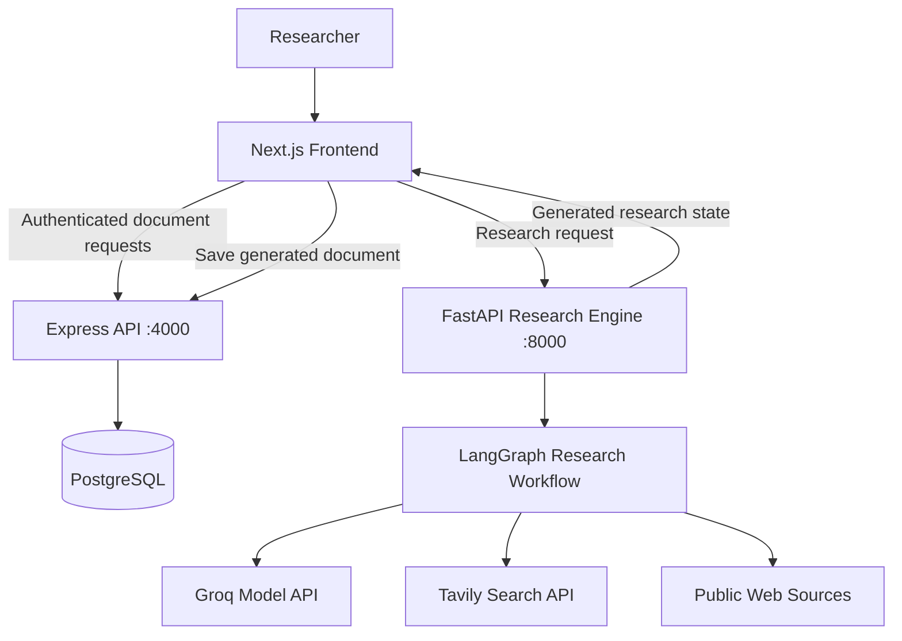
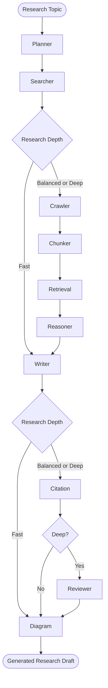

<div align="center">

# 🧠 ResearchFlow AI

### Multi-Agent Research Automation & Collaborative Document Workspace

[](https://nextjs.org/)
[](https://fastapi.tiangolo.com/)
[](https://expressjs.com/)
[](https://www.langchain.com/langgraph)
[](https://www.postgresql.org/)
[](LICENSE)

**Plan research, discover sources, generate structured drafts, and organize documents in one workspace.**

ResearchFlow AI combines a Next.js application, an Express API, and a LangGraph-powered Python research engine. It supports configurable research depth, six document objectives, source discovery, report generation, and PostgreSQL-backed document management. The repository also includes components and API modules for collaborative research workflows.

</div>

> **Project status:** Active development. Some collaboration, security, export, and infrastructure capabilities described below require verification against the complete repository before they should be considered production-ready. Generated research is a draft and must be reviewed before academic or professional use.

<!-- Add actual application screenshots or a short demo GIF here.

-->

## Contents

- [Overview](#overview)
- [Technology Stack](#technology-stack)
- [Architecture](#architecture)
- [Research Pipeline](#research-pipeline)
- [Research Depths](#research-depths)
- [Document Types](#document-types)
- [Document Management and Collaboration](#document-management-and-collaboration)
- [Authentication and Security](#authentication-and-security)
- [Data Model](#data-model)
- [Project Structure](#project-structure)
- [Getting Started](#getting-started)
- [API Reference](#api-reference)
- [Testing and Verification](#testing-and-verification)
- [Known Limitations](#known-limitations)
- [Roadmap](#roadmap)
- [License](#license)

## Overview

ResearchFlow AI is designed to reduce the manual work involved in gathering web sources, organizing evidence, and drafting technical or academic research documents.

The workflow begins with a topic, document type, and research depth. A LangGraph workflow then coordinates research stages, producing a Markdown report and, where applicable, a Mermaid diagram. The frontend displays the result and submits it to the Express document API for persistence.

**Core capabilities represented in the reviewed code:**

- Configurable **Fast**, **Balanced**, and **Deep** research workflows.
- Topic-specific query planning and web search with Tavily.
- Web content extraction using BeautifulSoup for workflows that include crawling.
- Modular processing stages for chunking, retrieval, reasoning, writing, citation formatting, review, and diagrams.
- Six document-generation objectives.
- Document listing, creation, and deletion through the Express API, with authenticated requests from the frontend.
- A frontend document workspace and collaboration-related interface components.

> **Implementation note:** The complete Express gateway, all agent modules, export components, and collaboration modules have not been independently audited for this README revision. Their presence in the original project documentation is not proof that every behavior is fully implemented or secure.

## Technology Stack

| Layer | Technologies | Purpose |
|---|---|---|
| Frontend | Next.js, React, TypeScript, Tailwind CSS | Research console, document views, workspace interface |
| Application API | Node.js, Express, Sequelize | Authentication, documents, workspace APIs, database access |
| Research API | Python, FastAPI, Pydantic | Research request handling and workflow execution |
| Agent orchestration | LangGraph | Shared research state and ordered workflow execution |
| Research services | Groq, Tavily, BeautifulSoup | Model inference, web search, and HTML text extraction |
| Data storage | PostgreSQL | Users, documents, and collaboration-related records |
| Visualization | Mermaid.js | Research and architecture diagrams |

**Optional or unverified infrastructure:** Redis/BullMQ and PostgreSQL `pgvector` were mentioned in earlier project documentation, but their runtime use was not established by the reviewed code. They are not listed as required dependencies here.

## Architecture



**Current integration detail:** In the reviewed frontend, the browser calls the FastAPI research endpoint directly, then sends the generated document to Express for storage. This is **not** an Express-to-FastAPI internal proxy architecture. Production deployments should protect the research API and use environment-specific service URLs.

### Research request lifecycle

1. The user selects a research topic, document type, depth, and preferred output format.
2. The frontend sends `question`, `depth`, `doc_type`, and `initiated_by` to the FastAPI research endpoint.
3. FastAPI invokes the selected LangGraph workflow.
4. The workflow returns research state containing the generated report and other available outputs.
5. The frontend displays the report and, when an authenticated session is available, sends the report to the Express document API.
6. The Express API handles document persistence and associated workspace data according to its implementation.

The output-format selection is passed to the document-saving API in the reviewed frontend; generation of a PDF or `.tex` file must be verified in the corresponding export component.

## Research Pipeline

The Python research engine registers **10 workflow nodes**. Not every node executes at every depth.



The diagram summarizes the three configured routes. The actual `graph.py` builds a separate, linear path for each depth; it does not implement a conditional revision cycle.

| Node | Module | Responsibility |
|---|---|---|
| Planner | `agents/planner.py` | Normalize the topic and prepare document-specific search queries. |
| Searcher | `agents/searcher.py` | Discover sources through Tavily when configured. |
| Crawler | `agents/crawler.py` | Retrieve web pages and remove common HTML boilerplate. |
| Chunker | `agents/chunker.py` | Split retrieved text into manageable units. |
| Vector RAG | `agents/vector_rag.py` | Select relevant context for subsequent stages; verify the exact retrieval algorithm in this module. |
| Reasoner | `agents/reasoner.py` | Organize and synthesize research findings. |
| Writer | `agents/writer.py` | Draft the selected document structure. |
| Citation | `agents/citation.py` | Add or format references. Citation validity is not guaranteed. |
| Reviewer | `agents/reviewer.py` | Evaluate the draft in the Deep route. |
| Diagram | `agents/diagram.py` | Produce a Mermaid representation where supported. |

## Research Depths

| Depth | Executed nodes | Description |
|---|---:|---|
| **Fast** | 4 | Planner → Searcher → Writer → Diagram |
| **Balanced** | 9 | Planner → Searcher → Crawler → Chunker → Vector RAG → Reasoner → Writer → Citation → Diagram |
| **Deep** | 10 | Balanced stages plus Reviewer before Diagram |

**Important:** Deep currently includes a review stage, **not** an automatic revise-and-review loop. Implementing revision would require conditional LangGraph edges, revision limits, and a clear stopping condition.

## Document Types

The frontend exposes six document objectives. The planner uses the selected objective to tailor its search queries.

| Document type | API value | Intended focus |
|---|---|---|
| Research Paper | `research_paper` | Research background, methodology, findings, and references |
| Technical Approach | `technical_approach` | Implementation strategy, protocols, constraints, and deployment |
| System Design | `system_design` | Components, data models, scalability, and reliability |
| Comparative Analysis | `comparative_analysis` | Alternatives, evaluation criteria, and trade-offs |
| Executive Summary | `executive_summary` | Context, key findings, and recommendations |
| Literature Review | `literature_review` | Research landscape, taxonomy, and open questions |

Document structures are generation targets, not guarantees of source quality, empirical validation, or publication readiness.

## Document Management and Collaboration

The frontend includes views for saved documents, document reading, sharing, and collaboration. The project documentation also describes workspace roles, invitations, comments, tasks, version history, section locks, and presence indicators.

### Workspace roles described by the project

| Role | Intended scope |
|---|---|
| Owner | Manage document and workspace membership |
| Editor | Edit document content and participate in collaboration |
| Researcher | Contribute research notes and source context |
| Reviewer | Review drafts and provide feedback |
| Viewer | Read shared content |

**Authorization requirement:** These permissions must be enforced in Express middleware and database queries. Hiding a button in the frontend is not a security control. Confirm route-level ownership and membership checks before relying on the role descriptions above.

### Collaboration feature verification

Before marking these features as fully supported, confirm their end-to-end behavior in the relevant frontend, Express routes, and database models:

- Workspace invitation links and join codes, including expiration and usage limits.
- Member role assignment and permission enforcement.
- Comments, tasks, and version snapshots.
- Section-level locks and conflict handling.
- Socket.io connection authentication, room authorization, and presence events.
- Markdown, PDF, and LaTeX export behavior.

## Authentication and Security

The application uses authenticated requests to the Express document API. The broader project design describes access tokens, rotating refresh tokens, password hashing, and role-based permissions. Exact token lifetimes, replay handling, and invalidation behavior must be verified against the Express authentication implementation and automated tests.

### Security considerations

| Area | Required safeguard / verification |
|---|---|
| Express authentication | Validate JWT signature, allowed algorithms, expiry, and user identity. |
| Refresh sessions | Verify rotation, secure storage, revocation, and replay behavior in code and tests. |
| Workspace access | Enforce permissions on every document and collaboration endpoint. |
| FastAPI research endpoint | Add authentication or restrict access behind a trusted authenticated service. |
| Request validation | Bound prompt size and validate supported depth and document-type values. |
| Web crawling | Restrict allowed URL schemes and block private/internal network targets, unsafe redirects, and oversized responses. |
| API secrets | Load from environment variables; never commit actual secrets or use predictable production fallbacks. |
| CORS | Allow only the frontend origins required by each deployment. |
| Error handling | Return safe public errors and log diagnostic details server-side. |
| Abuse protection | Apply appropriate request rate limits, timeouts, and concurrency limits to costly research jobs. |

> **Current code caution:** The reviewed FastAPI endpoint accepts research requests without a visible authentication dependency, uses wildcard CORS with credentials, and returns exception messages in HTTP 500 responses. The reviewed frontend also sends `initiated_by` as client-controlled data without a bearer token to FastAPI. These should be addressed before exposing the AI engine publicly.

**Password terminology:** bcrypt is a password-*hashing* mechanism, not reversible encryption.

## Data Model

The original project documentation lists the following 13 application tables. Treat this as a **documented schema inventory** until verified against Sequelize models and database migrations.

| Table | Purpose |
|---|---|
| `users` | Accounts and authentication metadata |
| `refresh_tokens` | Refresh-session records |
| `research_documents` | Generated reports and document metadata |
| `research_workspaces` | Collaboration workspaces |
| `workspace_members` | Workspace membership and roles |
| `workspace_invitations` | Invitations and join codes |
| `document_versions` | Document snapshots |
| `comments` | Document discussions |
| `tasks` | Collaborative work items |
| `agent_runs` | Research execution metadata |
| `activity_logs` | Recorded workspace actions |
| `notifications` | User notifications |
| `document_locks` | Section lock metadata |

If you use PostgreSQL extensions such as `pgvector`, document their installation, migrations, and index configuration explicitly.

## Project Structure

The following is a **condensed structure based on the original project documentation**. Confirm file names and remove entries that are not present in the public repository.

```text
Multiagent-Research-Platform/
├── client/
│   ├── src/
│   │   ├── app/
│   │   │   ├── layout.tsx
│   │   │   ├── page.tsx
│   │   │   └── globals.css
│   │   ├── components/
│   │   │   ├── auth/
│   │   │   └── dashboard/
│   │   └── context/
│   └── package.json
├── server/
│   ├── gateway/
│   │   ├── index.js
│   │   ├── db.js
│   │   ├── middleware/
│   │   └── routes/
│   └── ai_engine/
│       ├── main.py
│       ├── graph.py
│       ├── requirements.txt
│       └── agents/
│           ├── types.py
│           ├── planner.py
│           ├── searcher.py
│           ├── crawler.py
│           ├── chunker.py
│           ├── vector_rag.py
│           ├── reasoner.py
│           ├── writer.py
│           ├── citation.py
│           ├── reviewer.py
│           └── diagram.py
├── .env.example            # Recommended: add a sanitized template
├── .gitignore
└── README.md
```

## Getting Started

### Prerequisites

- **Node.js:** a version supported by the project's installed Next.js release (for Next.js 16, use Node.js 20.9+).
- **Python:** 3.11+ (verify against the pinned Python dependencies).
- **PostgreSQL:** a compatible local instance, typically on port `5432`.
- **Groq API key:** for model-backed research generation.
- **Tavily API key:** for live web search.

> Install commands below assume the directories and dependency files in the project structure exist. The complete repository has not been executed as part of this documentation update.

### 1. Clone the repository

```bash
git clone https://github.com/HetBhimani25/Multiagent-Research-Platform.git
cd Multiagent-Research-Platform
```

### 2. Configure environment variables

Create a root `.env` file. Prefer copying a committed `.env.example` if one is available.

```dotenv
# PostgreSQL
POSTGRES_HOST=localhost
POSTGRES_PORT=5432
POSTGRES_USER=postgres
POSTGRES_PASSWORD=replace_with_your_database_password
POSTGRES_DB=research_db

# Model and web search providers
DEFAULT_LLM_PROVIDER=groq
GROQ_API_KEY=replace_with_your_groq_api_key
GROQ_MODEL=replace_with_a_supported_groq_model
WEB_SEARCH_PROVIDER=tavily
TAVILY_API_KEY=replace_with_your_tavily_api_key

# Application authentication
JWT_SECRET=replace_with_a_cryptographically_random_secret

# Local development ports
PORT=4000
FASTAPI_PORT=8000
CLIENT_PORT=3000
```

Generate a random JWT secret using a cryptographically secure tool, for example:

```bash
node -e "console.log(require('crypto').randomBytes(32).toString('hex'))"
```

**Never commit `.env` or real credentials.** Confirm that the gateway and Python service read the intended environment file. Check whether additional refresh-token or frontend URL variables are required by the actual code.

### 3. Create the database

From PostgreSQL administration tools or a `psql` session with appropriate privileges:

```sql
CREATE DATABASE research_db;
```

Run the project's actual Sequelize migration or schema initialization process if required. Do not use a database wipe/reset script against data you need to preserve.

### 4. Start the Express gateway

Open a terminal from the repository root:

```bash
cd server/gateway
npm install
node index.js
```

The development gateway is expected to listen on `http://localhost:4000`, subject to its environment configuration.

### 5. Start the FastAPI research engine

Open a **new terminal from the repository root**:

```bash
cd server/ai_engine
python -m venv .venv
```

Activate the virtual environment:

```powershell
# Windows PowerShell
.\.venv\Scripts\Activate.ps1
```

```bash
# Linux / macOS
source .venv/bin/activate
```

Then install dependencies and run the API:

```bash
python -m pip install -r requirements.txt
uvicorn main:app --host 127.0.0.1 --port 8000 --reload
```

Check `http://localhost:8000/api/health` for a health response.

### 6. Start the frontend

Open a **third terminal from the repository root**:

```bash
cd client
npm install
npm run dev
```

Open **http://localhost:3000**.

### 7. Verify a local research flow

1. Register or sign in using the application's UI.
2. Open the research console and enter a short topic.
3. Select a document type and **Fast** depth.
4. Generate a report and inspect the result.
5. Check that the report appears in the saved documents view.
6. Verify that only authorized users can access or delete the document.

**Note on fallback search data:** The reviewed searcher can produce synthetic placeholder results if Tavily is unavailable. Such results are not genuine evidence and must not be treated as verified citations.

## API Reference

### Express document API (`http://localhost:4000`)

The reviewed frontend calls the following endpoints:

| Method | Endpoint | Purpose | Frontend sends JWT? |
|---|---|---|---|
| `GET` | `/api/documents` | List saved documents | Yes |
| `POST` | `/api/documents` | Save a generated document | Yes |
| `DELETE` | `/api/documents/:id` | Delete a document | Yes |
| `POST` | `/api/documents/migrate` | Import older locally stored documents | Yes |

The original documentation also describes `/api/auth`, `/api/workspaces`, and `/api/invitations` routes. Validate those paths, request schemas, and permission requirements against the actual Express router before treating them as a complete API reference.

### FastAPI research API (`http://localhost:8000`)

**`POST /api/research/run`**

Request example:

```json
{
  "question": "Compare REST and GraphQL for a medium-scale application",
  "depth": "balanced",
  "doc_type": "comparative_analysis"
}
```

Additional optional request fields defined in the reviewed FastAPI model: `workspace_id`, `document_id`, `initiated_by`, and `run_id`.

Successful response shape:

```json
{
  "status": "success",
  "data": {
    "report": "...",
    "search_queries": [],
    "mermaid_diagram": "..."
  }
}
```

The `data` object is the workflow state and may contain additional fields. The sample above is illustrative, not a guaranteed complete response.

**`GET /api/health`** returns a simple health status.

### Other API groups

The original project documentation lists authentication, workspace membership, invitations, comments, tasks, versions, and locks. Add detailed endpoint tables for those groups after verifying their actual route definitions and request/response contracts.

## Testing and Verification

The frontend build can be checked with:

```bash
cd client
npm run build
```

This is a build/type-compatibility check; it is **not** proof that authentication, authorization, or end-to-end workflows have been tested.

### Recommended automated test coverage

- Registration, login, logout, and authenticated profile access.
- Access-token expiration and invalid or malformed token rejection.
- Refresh-token rotation, reuse detection, and revocation, **if implemented**.
- Password hashing, password-change behavior, and session invalidation.
- Document ownership and workspace role enforcement across all routes.
- Invitation expiry, maximum use, and membership transitions.
- Input validation, rate limiting, and research endpoint access control.
- Safe URL handling in the crawler, including private-IP and redirect blocking.
- Research workflows for Fast, Balanced, and Deep depths.
- Source integrity: synthetic or unavailable search results must not appear as verified citations.
- Export output validity for Markdown, PDF, and LaTeX where supported.

**Before adding a “Tests passing” badge:** Commit the test files, document the real test runner commands, and publish repeatable results (ideally through CI).

## Known Limitations

- AI-generated text may be inaccurate, incomplete, or unsuitable for publication without human review.
- Source discovery depends on third-party search availability and coverage.
- The reviewed searcher uses synthetic fallback results when search credentials are missing or live searches fail; these are placeholders, **not verifiable sources**.
- The current Deep workflow runs a reviewer once; it does not automatically revise the document in a feedback loop.
- The reviewed frontend calls FastAPI directly, and the reviewed FastAPI research endpoint lacks a visible authentication dependency.
- The exact implementation and reliability of collaborative editing, WebSocket presence, exports, and refresh-token security require verification in their respective modules.
- Local development endpoints and configuration are not production deployment instructions.

## Roadmap

The following are recommended next steps, not claims of existing functionality:

- [ ] Protect the research API through authenticated requests or an authenticated gateway.
- [ ] Replace synthetic search citations with explicit failure states or clearly marked demo data.
- [ ] Add conditional revision loops with bounded retries and measurable review criteria.
- [ ] Validate source provenance and citation-to-claim alignment.
- [ ] Add safe crawler URL validation, redirect controls, and response-size limits.
- [ ] Add end-to-end tests for authentication, document permissions, and collaboration.
- [ ] Document and test PDF/LaTeX exports.
- [ ] Add screenshots, a demo video, and reproducible deployment instructions.
- [ ] Add CI for builds, tests, and linting.

## License

This project is described as MIT-licensed. See [LICENSE](LICENSE) for the full terms. Confirm that the `LICENSE` file is present in the public repository.

---

<div align="center">
  <sub>ResearchFlow AI — structured research workflows and collaborative document tooling.</sub>
</div>
