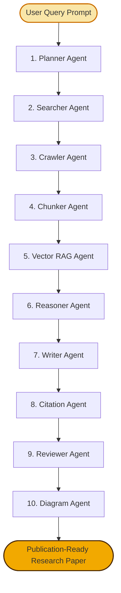
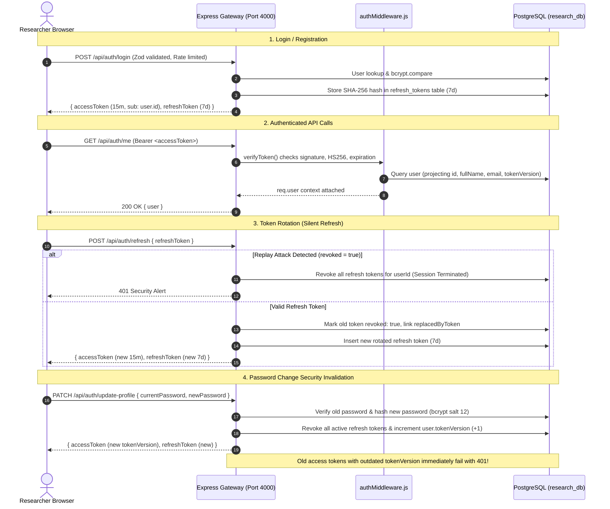
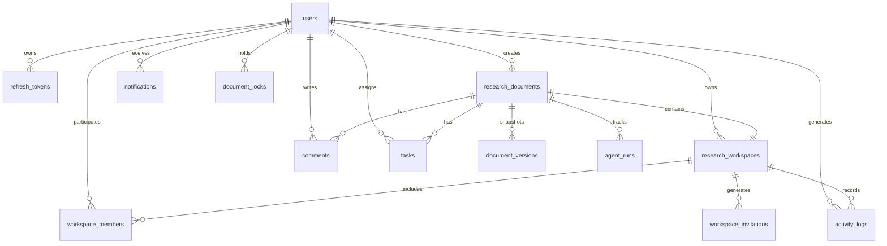

<div align="center">

# 🧠 ResearchFlow AI
### Autonomous Multi-Agent Research & Real-Time Collaborative Paper Workspace Platform

[](https://nextjs.org/)
[](https://fastapi.tiangolo.com/)
[](https://expressjs.com/)
[](https://www.langchain.com/langgraph)
[](https://www.postgresql.org/)
[](LICENSE)

<p align="center">
  <b>An enterprise-grade, stateful multi-agent literature research engine and real-time co-authoring workspace that autonomously plans, searches, crawls, chunks, vector-indexes, reasons, synthesizes, cites, critiques, and diagrams academic papers and technical specifications.</b>
</p>

</div>

---

## 📑 Table of Contents

- [Overview & Problem Statement](#-overview--problem-statement)
- [System Architecture (4-Tier Distributed Topology)](#-system-architecture-4-tier-distributed-topology)
- [The 10-Agent Autonomous Pipeline (LangGraph)](#-the-10-agent-autonomous-pipeline-langgraph)
- [Pipeline Execution Depths](#-pipeline-execution-depths)
- [Target Document Filtration System](#-target-document-filtration-system)
- [Enterprise Dual-Token Authentication & Security](#-enterprise-dual-token-authentication--security)
- [Collaborative Research Workspace & RBAC](#-collaborative-research-workspace--rbac)
- [Export Formats & Visualization](#-export-formats--visualization)
- [PostgreSQL Database Architecture (13 Tables)](#-postgresql-database-architecture-13-tables)
- [Project Directory Structure](#-project-directory-structure)
- [Installation & Quickstart Guide](#-installation--quickstart-guide)
- [API Reference](#-api-reference)
- [Verification & Automated Test Suite](#-verification--automated-test-suite)

---

## 🔬 Overview & Problem Statement

Modern academic research and technical design workflows face three critical bottlenecks:
1. **Search Fragmentation & Hallucination**: Manual literature reviews require sifting through dozens of search tabs. Raw generative LLMs often hallucinate facts and invent false academic references.
2. **Lack of Structured Synthesis**: Raw prompts produce shallow overviews rather than structured, publication-grade academic papers or technical RFC specifications with diagrams and verified citations.
3. **Siloed Co-Authoring**: Once generated, research remains static and isolated, lacking team collaboration, granular role permissions, section locking, inline comments, and task assignment.

### The ResearchFlow AI Solution
**ResearchFlow AI** solves this by uniting a **Stateful LangGraph 10-Agent Pipeline** with a **Real-Time PostgreSQL Collaborative Workspace**:
- **Autonomous Investigation**: Decomposes complex queries into targeted search sub-queries, scrapes live web pages, strips boilerplate HTML, breaks content into 800-character semantic chunks, and ranks evidence using cosine vector similarity.
- **Architectural Synthesis**: Synthesizes verified technical insights and renders domain-specific blueprints with embedded **Mermaid.js flowcharts** and verified external citations.
- **Real-Time Collaboration**: Automatically creates private workspaces where document owners can invite colleagues as **Editors, Researchers, Reviewers, or Viewers** with section locking, threaded discussions, version history, and real-time WebSocket presence.

---

## 🏛️ System Architecture (4-Tier Distributed Topology)

```
┌─────────────────────────────────────────────────────────────────────────────┐
│                           1. CLIENT FRONTEND LAYER                          │
│           Next.js 16 (App Router) • React 19 • Tailwind CSS v4             │
│   • Research Console            • Real-time Agent Pipeline Tracker          │
│   • Interactive Reader          • Collaborative Workspace Drawer            │
│   • Threaded Comments / Tasks   • Live Mermaid.js Flowchart Rendering       │
└──────────────────────┬───────────────────────────────▲──────────────────────┘
                       │ HTTP / SSE / REST             │ WebSocket (Socket.io)
                       ▼                               │
┌──────────────────────────────────────────────┐       │
│         2. BACKEND GATEWAY LAYER             │       │
│          Node.js • Express 5                 │       │
│  • Dual-Token Auth (15m Access / 7d Refresh) │       │
│  • Role-Based Access Control (RBAC)          │       │
│  • Zod Request Validation & Rate Limiting    │───────┘
│  • Sequelize ORM Database Transactions       │
│  • Document & Workspace Management APIs      │
└──────────────┬───────────────────────────────┘
               │ Internal Forwarding / IPC
               ▼
┌──────────────────────────────────────────────┐       ┌──────────────────────┐
│            3. AI RESEARCH ENGINE             │       │ 4. DATABASE & STATE  │
│        Python 3.11+ • FastAPI                │       │     PostgreSQL 16    │
│  • LangGraph Stateful Workflow Graph (DAG)   │──────▶│  • 13 Core Tables    │
│  • 10 Autonomous Pipeline Agents             │       │  • pgvector Indexing │
│  • Groq LPU Ultra-Low Latency Inference      │       │  • Relational Graphs │
│  • Tavily Web Search & HTML Cleansing        │       │  • BullMQ / Redis    │
└──────────────────────────────────────────────┘       └──────────────────────┘
```

---

## 🤖 The 10-Agent Autonomous Pipeline (LangGraph)

The AI engine executes as a stateful Directed Acyclic Graph (DAG) powered by **LangGraph**:



| # | Agent Name | Implementation File | Primary Responsibility |
|:---:|:---|:---|:---|
| **1** | **Planner Agent** | `agents/planner.py` | Strips prompt noise and decomposes queries into 3–5 specialized sub-queries tailored to the chosen document type. |
| **2** | **Searcher Agent** | `agents/searcher.py` | Queries Tavily Search API across web sources, whitepapers, and arXiv preprints. |
| **3** | **Crawler Agent** | `agents/crawler.py` | Scrapes raw HTML and uses BeautifulSoup to purge scripts, styles, advertisements, navigation bars, and footers. |
| **4** | **Chunker Agent** | `agents/chunker.py` | Segments extracted text into ~800-character semantic chunks with 100-character overlap at sentence boundaries. |
| **5** | **Vector RAG Agent** | `agents/vector_rag.py` | Performs vector indexing and cosine similarity scoring against the topic, returning the top-5 contextual evidence snippets. |
| **6** | **Reasoner Agent** | `agents/reasoner.py` | Analyzes evidence to extract core architectural trade-offs, network constraints, and failure modes. |
| **7** | **Writer Agent** | `agents/writer.py` | Drafts the full paper in Markdown adhering strictly to domain-specific blueprints and structural outlines. |
| **8** | **Citation Agent** | `agents/citation.py` | Audits factual claims, maps external URLs, and constructs an IEEE-compliant `## References` section. |
| **9** | **Reviewer Agent** | `agents/reviewer.py` | Performs automated peer review, verifying required section headings and evaluating structural completeness (score 0–100). |
| **10** | **Diagram Agent** | `agents/diagram.py` | Synthesizes system components and embeds interactive, horizontal **Mermaid.js** architecture flowcharts into the document. |

---

## ⚡ Pipeline Execution Depths

Users can adjust research depth to balance speed and analytical rigor:

- 🚀 **Fast (3 Agents • Direct)**:
  - Pipeline: `Planner` ➔ `Searcher` ➔ `Writer` ➔ `Diagram` ➔ `END`
  - *Best for*: Instant overviews, executive briefs, rapid technical lookups.
- ⚖️ **Balanced (8 Agents • 1 Loop)**:
  - Pipeline: `Planner` ➔ `Searcher` ➔ `Crawler` ➔ `Chunker` ➔ `Vector RAG` ➔ `Reasoner` ➔ `Writer` ➔ `Citation` ➔ `Diagram` ➔ `END`
  - *Best for*: Detailed technical approaches, system design specs, architectural RFCs.
- 🎓 **Deep Academic (10 Agents • Full Loop)**:
  - Pipeline: Full 10 Agents including the `Reviewer Agent` critique loop.
  - *Best for*: Full academic literature surveys, benchmark evaluations, publication drafts.

---

## 🎯 Target Document Filtration System

The platform dynamically shapes planning sub-queries, writer templates, and diagram topologies across **6 distinct document objectives**:

```
Document Types
├── 📄 Research Paper ("research_paper")
│   └── Abstract, Introduction, Problem Formulation, Algorithmic Design, Empirical Findings, References
├── 🛠️ Technical Approach ("technical_approach")
│   └── Executive Summary, Non-Goals, System Architecture, Core Protocols, Security & Isolation, Deployment Plan
├── 📐 System Design Blueprint ("system_design")
│   └── Architectural Overview, Component Topology, Data Models & Storage, Concurrency & HA, Observability
├── 📊 Comparative Analysis & Benchmarks ("comparative_analysis")
│   └── Evaluation Scope, Feature Comparison Matrix Table, Latency/Throughput Trade-offs, Decision Matrix
├── 💼 Executive Whitepaper ("executive_summary")
│   └── Strategic Context, Market Drivers, Core Solution Architecture, Enterprise ROI & Productivity
└── 📚 Literature Review ("literature_review")
    └── Survey Scope, Taxonomic Classification, Milestone Evolution, Synthesis of Approaches, Open Horizons
```

---

## 🛡️ Enterprise Dual-Token Authentication & Security

The platform implements an **industry-standard Dual-Token JWT Architecture**:



### Key Security Safeguards
- **Short-Lived Access Token (15 mins)**: Contains standard `sub: user.id` and `tokenVersion`. Does not expose user email.
- **Long-Lived Rotating Refresh Token (7 days)**: 40-byte cryptographically random hex token stored as a SHA-256 hash in PostgreSQL.
- **Replay & Reuse Detection**: Replaying an already-rotated token triggers immediate family revocation, invalidating all sessions for that account.
- **Instant Invalidation on Password Update**: Increments `tokenVersion` in PostgreSQL; old access tokens fail immediately with `401 Unauthorized` without forcing the active user to re-login.
- **Model Lifecycle Encryption**: Sequelize `beforeCreate` and `beforeUpdate` hooks ensure plaintext passwords never touch the database. Passwords are stripped automatically via `User.prototype.toJSON()`.
- **Validation & Rate Limiting**: Strict Zod schemas and `express-rate-limit` (15 login attempts per 15 mins).

---

## 👥 Collaborative Research Workspace & RBAC

Every generated document automatically provisions a collaborative workspace with **Role-Based Access Control (RBAC)**:

```
Role Hierarchy
└── 👑 OWNER (Document Creator)
    ├── Manage workspace settings, transfer ownership, delete document
    ├── Generate / Revoke Invite Links & 6-character Invite Codes
    ├── Change member roles & remove collaborators
    └── Lock / Unlock document sections
└── ✏️ EDITOR
    ├── Edit document text, create versions & snapshots
    ├── Add comments, create tasks, assign tasks
    └── Export in all formats
└── 🔍 RESEARCHER
    ├── Add research notes, sources, and literature context
    ├── Create tasks, add comments, use Chat-with-Paper
    └── Cannot modify finalized document text directly
└── 🧐 REVIEWER
    ├── Quality assurance, suggest changes, approve/reject suggestions
    └── Comment, view version history, use Chat-with-Paper
└── 👁️ VIEWER
    └── Read-only access to paper, citations, and export
```

### Real-Time Collaboration Features
- **Invite Links & Codes**: Generate shareable links or 6-character join codes with expiration dates and maximum usage thresholds.
- **Section Locking**: Granular section-level locks prevent concurrent conflicting edits.
- **Threaded Comments**: Inline contextual discussions with reply hierarchies and resolved/unresolved toggles.
- **Collaborative Tasks**: Assign actionable to-dos with statuses (`TODO`, `IN_PROGRESS`, `DONE`, `BLOCKED`).
- **Version History**: Immutable document snapshots with version numbering and rollback capabilities.
- **Live WebSocket Presence**: Broadcast active member cards and typing events via Socket.io.

---

## 📄 Export Formats & Visualization

- **Interactive Markdown Reader**: Syntax highlighting, collapsible headings, and one-click clipboard copying.
- **IEEE Academic PDF**: Custom print formatter converting Markdown and Mermaid blocks into formal 2-column IEEE layout cards.
- **LaTeX Source (.tex)**: Clean download wrapped in standard `\documentclass{article}` with escaped sections and citations.
- **Embedded Mermaid Diagrams**: Rendered inline using `mermaid.js` with zoom and pan controls.

---

## 🗄️ PostgreSQL Database Architecture (13 Tables)



### Table Dictionary
1. **`users`**: UUID primary key, `fullName`, unique `email`, bcrypt `password` hash, `tokenVersion`.
2. **`refresh_tokens`**: UUID, `userId`, `tokenHash` (SHA-256), `expiresAt`, `revoked` flag, `replacedByToken`, `family`.
3. **`research_documents`**: `topic`, `report` (TEXT), `depth`, `format`, `status`, `docType`, `mermaidDiagram`, `metadata`.
4. **`research_workspaces`**: `name`, `description`, `ownerId`, `documentId`, `status`, `visibility`.
5. **`workspace_members`**: `workspaceId`, `userId`, `role` (`OWNER`, `EDITOR`, `RESEARCHER`, `REVIEWER`, `VIEWER`), `status`.
6. **`workspace_invitations`**: `workspaceId`, `invitedBy`, `inviteType` (`LINK`/`CODE`), `tokenHash`, `role`, `maxUses`, `usedCount`, `expiresAt`.
7. **`document_versions`**: `documentId`, `workspaceId`, `versionNumber`, `content`, `changeSummary`, `createdBy`.
8. **`comments`**: `documentId`, `authorId`, `sectionId`, `content`, `parentCommentId`, `status`, `resolvedBy`.
9. **`tasks`**: `documentId`, `workspaceId`, `title`, `description`, `status`, `priority`, `assignedTo`, `createdBy`, `dueDate`.
10. **`agent_runs`**: `documentId`, `workspaceId`, `initiatedBy`, `status`, `plan`, `searchQueries`, `metrics`.
11. **`activity_logs`**: `workspaceId`, `documentId`, `userId`, `action`, `entityType`, `entityId`, `metadata`.
12. **`notifications`**: `userId`, `workspaceId`, `title`, `message`, `type`, `isRead`.
13. **`document_locks`**: `documentId`, `sectionId`, `lockedBy`, `lockType`, `expiresAt`.

---

## 📂 Project Directory Structure

```text
Research Automation Platform/
├── client/                               # Next.js 16 Frontend
│   ├── src/
│   │   ├── app/
│   │   │   ├── layout.tsx                # App root shell & metadata
│   │   │   ├── page.tsx                  # Main router, auth guards & views
│   │   │   └── globals.css               # Tailwind CSS theme tokens
│   │   ├── components/
│   │   │   ├── auth/
│   │   │   │   ├── LoginView.tsx         # Sign-in form with demo shortcuts
│   │   │   │   └── SignUpView.tsx        # Registration with Zod length checks
│   │   │   ├── dashboard/
│   │   │   │   ├── ResearchInputConsole.tsx  # Document type, depth & format controls
│   │   │   │   ├── AgentPipelineTracker.tsx  # Step-by-step agent progress tracker
│   │   │   │   ├── PaperWorkspace.tsx        # Document reader, editor & export modal
│   │   │   │   ├── MyDocumentsView.tsx       # Document cards & management
│   │   │   │   ├── SidebarDrawer.tsx         # Navigation, notifications & user profile
│   │   │   │   ├── CommentPanel.tsx          # Threaded comment threads
│   │   │   │   ├── TaskPanel.tsx             # Collaborative tasks board
│   │   │   │   ├── VersionHistory.tsx        # Document snapshots & revision rollback
│   │   │   │   ├── ShareDocumentModal.tsx    # Invite link & invite code manager
│   │   │   │   └── MermaidDiagram.tsx        # Interactive Mermaid.js viewer
│   │   │   └── UserProfileModal.tsx      # PATCH profile name & password update modal
│   │   └── context/
│   │       ├── AuthContext.tsx           # Dual-token management & silent rotation
│   │       └── ThemeContext.tsx          # Color scheme provider
│   └── package.json
│
├── server/
│   ├── gateway/                          # Node.js / Express Gateway Server
│   │   ├── index.js                      # HTTP server, WebSockets & router mounts
│   │   ├── db.js                         # Sequelize PostgreSQL connection & 13 models
│   │   ├── wipe_database.js              # Database reset & synchronization script
│   │   ├── middleware/
│   │   │   ├── authMiddleware.js         # JWT verification, sub claim & tokenVersion check
│   │   │   ├── workspaceAuth.js          # Workspace permission verification
│   │   │   └── permissions.js            # Granular RBAC permission constants
│   │   └── routes/
│   │       ├── auth.js                   # Zod register, login, refresh, logout, PATCH profile
│   │       ├── documents.js              # Document creation & workspace provisioning
│   │       ├── workspaces.js             # Member management & role assignment
│   │       ├── invitations.js            # Invite link & code verification
│   │       ├── comments.js               # Threaded comment CRUD & resolution
│   │       ├── tasks.js                  # Task assignment & status updates
│   │       ├── versions.js               # Document version snapshots
│   │       └── locks.js                  # Real-time section locking
│   │
│   └── ai_engine/                        # Python / FastAPI AI Research Engine
│       ├── main.py                       # FastAPI API server & research endpoint
│       ├── graph.py                      # LangGraph StateGraph DAG builder (Fast, Balanced, Deep)
│       └── agents/
│           ├── types.py                  # ResearchState & DocumentChunk TypedDict definitions
│           ├── planner.py                # Agent 1: Query decomposition by document type
│           ├── searcher.py               # Agent 2: Tavily web discovery
│           ├── crawler.py                # Agent 3: HTML cleansing & boilerplate extraction
│           ├── chunker.py                # Agent 4: 800-char semantic text chunker
│           ├── vector_rag.py             # Agent 5: TF cosine similarity vector ranking
│           ├── reasoner.py               # Agent 6: Analytical trade-off reasoner
│           ├── writer.py                 # Agent 7: RFC blueprint markdown synthesizer
│           ├── citation.py               # Agent 8: Verified IEEE reference mapper
│           ├── reviewer.py               # Agent 9: Academic peer reviewer & scoring
│           └── diagram.py                # Agent 10: Horizontal Mermaid flowchart generator
│
├── .env                                  # Unified environment configuration
└── README.md                             # Project documentation
```

---

## 🚀 Installation & Quickstart Guide

### Prerequisites
- **Node.js**: v18.x or v20.x+
- **Python**: v3.11+
- **PostgreSQL**: v15+ or v16+ (running on port `5432`)
- **API Keys**:
  - [Groq API Key](https://console.groq.com) (free tier supported)
  - [Tavily Search API Key](https://tavily.com) (free tier supported)

---

### Step 1: Clone the Repository & Configure Environment
```bash
git clone https://github.com/your-username/researchflow-ai.git
cd researchflow-ai
```

Create a root `.env` file:
```env
# ── Database Setup ──
POSTGRES_HOST=localhost
POSTGRES_PORT=5432
POSTGRES_USER=postgres
POSTGRES_PASSWORD=your_postgres_password
POSTGRES_DB=research_db

# ── API Keys ──
DEFAULT_LLM_PROVIDER=groq
GROQ_API_KEY=gsk_your_groq_api_key_here
GROQ_MODEL=qwen/qwen3.8-27b

WEB_SEARCH_PROVIDER=tavily
TAVILY_API_KEY=tvly_your_tavily_api_key_here

# ── Security & Authentication ──
JWT_SECRET=super_secret_jwt_access_key_min_32_characters_here

# ── Service Ports ──
PORT=4000
FASTAPI_PORT=8000
CLIENT_PORT=3000
```

---

### Step 2: Initialize Database
Open PostgreSQL (`psql` or pgAdmin) and create the database:
```sql
CREATE DATABASE research_db;
```

---

### Step 3: Start the Backend Gateway (Port 4000)
```bash
cd server/gateway
npm install
node index.js
```
*Expected log output:*
```text
Gateway server running on http://localhost:4000
PostgreSQL database connected successfully via Sequelize.
All collaboration database models synchronized.
```

---

### Step 4: Start the AI Research Engine (Port 8000)
In a second terminal:
```bash
cd server/ai_engine
python -m venv .venv

# Windows:
.\.venv\Scripts\Activate.ps1
# Linux / macOS:
source .venv/bin/activate

pip install -r requirements.txt
uvicorn main:app --port 8000 --reload
```
*Expected log output:*
```text
INFO: Uvicorn running on http://127.0.0.1:8000 (Press CTRL+C to quit)
```

---

### Step 5: Start the Next.js Client (Port 3000)
In a third terminal:
```bash
cd client
npm install
npm run dev
```

Open your browser at **`http://localhost:3000`**.

---

## 📡 API Reference

### Authentication Endpoints (`/api/auth`)
| Method | Endpoint | Description | Auth Required |
|:---:|:---|:---|:---:|
| `POST` | `/api/auth/register` | Register user with Zod validation (min 8 char password); issues access + refresh tokens | No |
| `POST` | `/api/auth/login` | Authenticate user (rate limited 15 requests / 15 mins); issues dual tokens | No |
| `POST` | `/api/auth/refresh` | Rotate refresh token; issues new 15m access token & rotated 7d refresh token | No |
| `POST` | `/api/auth/logout` | Revoke refresh token and terminate active session | Optional |
| `GET` | `/api/auth/me` | Fetch authenticated user profile (verifies `decoded.sub` and `tokenVersion`) | Yes (Bearer) |
| `PATCH` | `/api/auth/update-profile` | Update full name or change password; invalidates old tokens upon password change | Yes (Bearer) |

### Document & Workspace Endpoints (`/api/documents` & `/api/workspaces`)
| Method | Endpoint | Description | Auth Required |
|:---:|:---|:---|:---:|
| `GET` | `/api/documents` | Fetch all documents owned by or shared with current user | Yes (Bearer) |
| `POST` | `/api/documents` | Save generated research paper; auto-provisions Workspace & `OWNER` role | Yes (Bearer) |
| `GET` | `/api/documents/:id` | Retrieve document details, workspace metadata, and user role | Yes (Bearer) |
| `DELETE` | `/api/documents/:id` | Delete document and cascade-delete its workspace (Owner only) | Yes (Bearer) |
| `POST` | `/api/workspaces/:id/invitations/link` | Generate shareable invite link with expiration | Yes (Owner) |
| `POST` | `/api/workspaces/:id/invitations/code` | Generate 6-character workspace join code | Yes (Owner) |
| `POST` | `/api/invitations/join` | Join workspace via 6-character code | Yes (Bearer) |

### AI Engine Endpoint (`http://localhost:8000/api/research`)
| Method | Endpoint | Payload | Output |
|:---:|:---|:---|:---|
| `POST` | `/api/research/run` | `{ question, depth, doc_type, initiated_by }` | Complete research state including Markdown paper, search queries, cited references, and Mermaid diagram |

---

## 🧪 Verification & Automated Test Suite

The system includes automated tests verifying the complete authentication and security lifecycle:

- ✅ **Test 1**: Zod input validation (rejection of malformed emails and short passwords).
- ✅ **Test 2**: Registration and dual-token issuance (15m Access Token + 7d Refresh Token).
- ✅ **Test 3**: Access Token standard `sub: user.id` claim validation with 15-minute expiration.
- ✅ **Test 4**: Password hashing verified with bcrypt salt 12; refresh tokens stored as SHA-256 hashes.
- ✅ **Test 5**: Middleware `/api/auth/me` attribute projection ensuring zero password hash leakage.
- ✅ **Test 6**: Refresh token rotation on `/api/auth/refresh` (old token revoked, new token generated).
- ✅ **Test 7**: Replay attack prevention: reused refresh tokens terminate all active sessions immediately.
- ✅ **Test 8**: Session re-authentication lifecycle.
- ✅ **Test 9**: `PATCH /api/auth/update-profile` credential verification and token re-issuance.
- ✅ **Test 10**: Immediate rejection of old access tokens following a password update (`401 Unauthorized`).
- ✅ **Test 11**: Credential update verification on login.
- ✅ **Test 12**: Clean logout and token revocation.

To verify Next.js type safety and compile status:
```bash
cd client
npm run build
```

---

## 📜 License

This project is licensed under the **MIT License** — see the [LICENSE](LICENSE) file for details.

---

<div align="center">
  <sub>Built with ❤️ for autonomous academic literature research and collaborative paper authoring.</sub>
</div>
